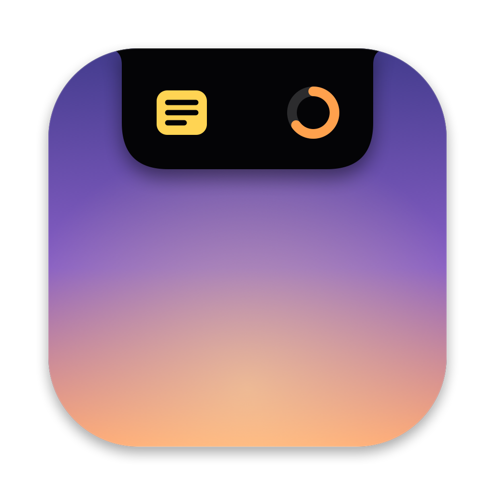

# Island

A floating "dynamic island" for the Mac that lives at the top-center of your screen. It works on Macs with or without a notch. It ships **Quick Notes**, a **Focus timer** and **Clipboard history**. Now Playing and dev tools are planned as more modules.

- **⌥Space** anywhere opens the island with the cursor in the capture bar
- **⏎** saves a quick note · **⌘⏎** saves and closes · **Esc** closes and returns you to your previous app
- **⌘N** new note · **⌘F** search · right-click a note → Show in Finder / Move to Trash
- **Settings** (gear button in the island, or **⌘,**): switch the Notes, Focus and Clipboard modules on or off, and set open on hover, launch at login, the timer sound and how much clipboard history to keep.
- **Open on Hover** (Settings, or menu bar icon → Open on Hover): rest the mouse on the pill and it opens; move away and it closes. Once you click or type in it, it stays open until you press Esc or click elsewhere.
- **⌃⌥V** anywhere opens Clipboard history directly
- **⌘1 / ⌘2 / ⌘3** switch between Notes, Focus and Clipboard
- **Focus**: 25/5, 50/10 or 15/3 Pomodoro blocks, or **Custom** with your own focus (1–180 min) and break (1–60 min) lengths. **Space** starts or pauses. Breaks start automatically, and a sound plus a glow on the pill tells you when a block ends. While it runs, the pill shows the countdown and a progress line. You also see today's sessions and minutes focused.
- **Clipboard**: remembers the last 200 copies (text, images, files from Finder). Pinned items never expire. Search, use **↑↓** and **⏎** to paste back into the app you came from. **⌘P** pins and **⌘⌫** deletes. Links, hex colors and code get their own previews. Copies that password managers mark as secret are never stored. You can pause recording from the tab or the menu bar. History lives only in `~/Library/Application Support/Island/`.
  - *Auto-paste* (pressing ⌘V for you) needs Island to be allowed under System Settings → Privacy & Security → Accessibility. Without it, ⏎ copies and you press ⌘V yourself. Each rebuild of an ad-hoc-signed app may need that permission granted again.
- Notes are plain Markdown files in `~/Documents/Island Notes`, so you can edit them with any editor. No account, no server, no tracking.



## Install

Download `Island.dmg` from the [latest release](../../releases/latest), open it and drag **Island** into **Applications**. The app isn't notarized yet, so the first time you launch it, right-click the app → **Open** → **Open**. (On macOS 15+, if that is blocked: System Settings → Privacy & Security → **Open Anyway**.)

## Build

Requires macOS 14+ and Xcode 15+ (Swift 5.9+).

```bash
swift test                      # unit tests for the notes store
scripts/build-app.sh            # -> build/Island.app (universal: Intel + Apple silicon)
scripts/build-app.sh --dmg      # also -> build/Island.dmg
scripts/make-icon.sh            # redraw Resources/AppIcon.icns from scripts/make-icon.swift
```

The app is ad-hoc signed. On another Mac, right-click → **Open** the first time. Notarizing with an Apple Developer ID removes that step.

Dev aid: `ISLAND_SNAPSHOT=/some/dir .build/debug/Island` writes PNGs of each island state (collapsed, notes, focus, clipboard with demo items, collapsed with timer) and quits. It never reads your real clipboard history. You can check the UI this way without Screen Recording permission.

## Layout

- `Sources/IslandCore`: `NotesStore` (Markdown files on disk), `FocusTimer` (Pomodoro logic + daily stats) and `ClipboardHistory` (dedupe, pinning, limits, persistence), all unit-tested
- `Sources/Island/IslandPanel.swift`: borderless always-on-top panel, notch-aware geometry
- `Sources/Island/IslandController.swift`: expand/collapse, focus handling, keyboard shortcuts
- `Sources/Island/HotKey.swift`: global ⌥Space / ⌃⌥V via Carbon (no Accessibility permission needed)
- `Sources/Island/ClipboardMonitor.swift`: watches the pasteboard, skips secrets, copies back and auto-pastes
- `Sources/Island/Theme.swift`: colors, card/field/row surfaces and the notch-style island shape
- `Sources/Island/IslandView.swift` (pill), `ExpandedView.swift` (tabs), `NotesView.swift`, `FocusView.swift`, `ClipboardView.swift`, `SettingsView.swift`: SwiftUI UI
